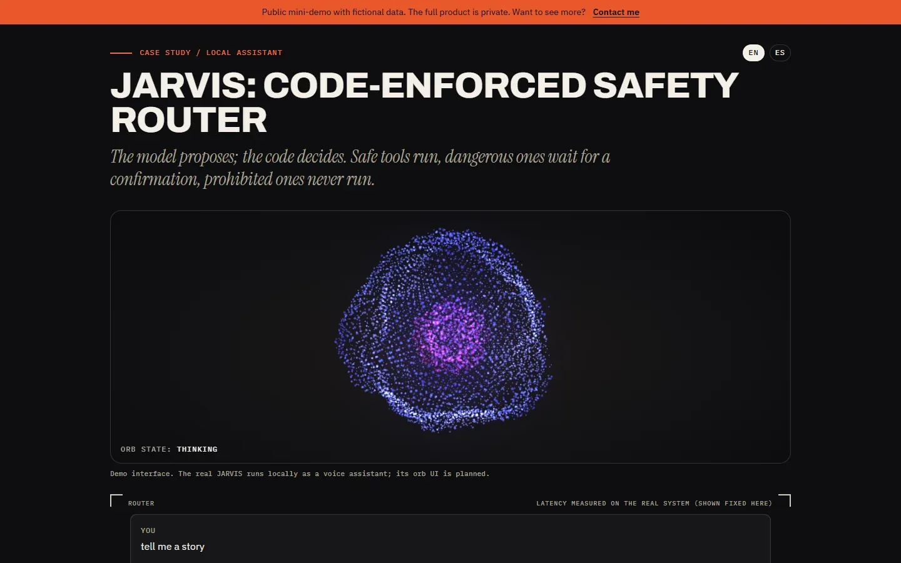
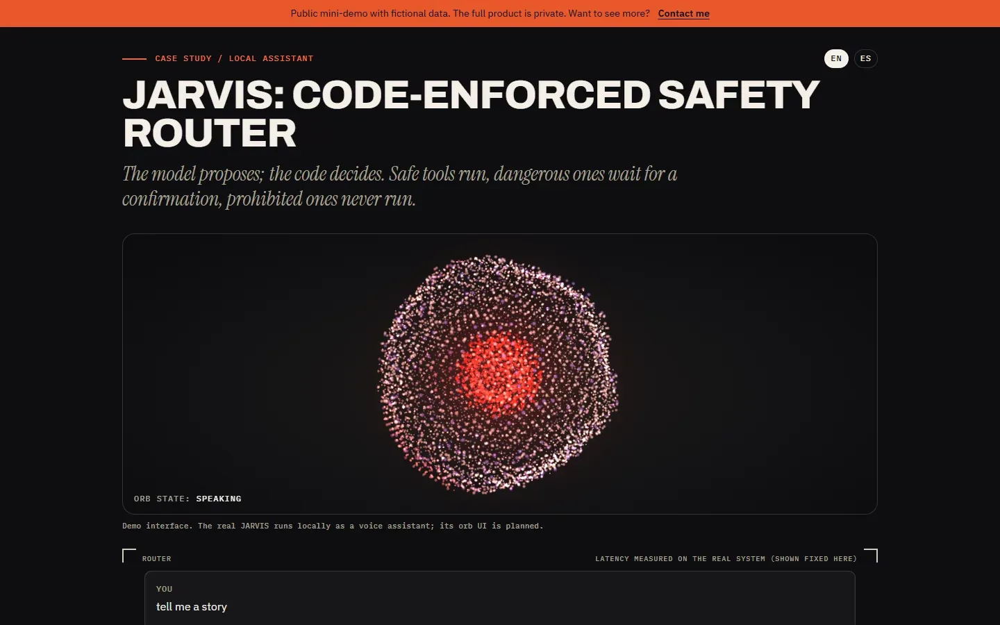
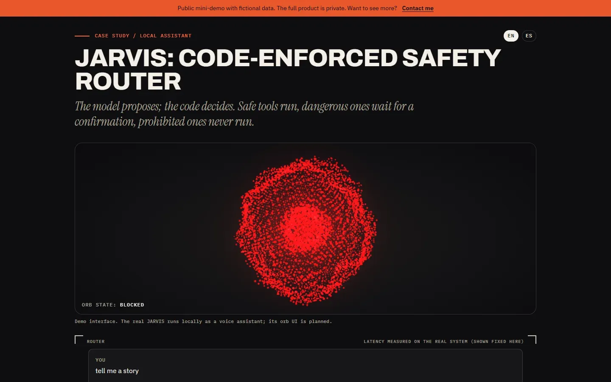
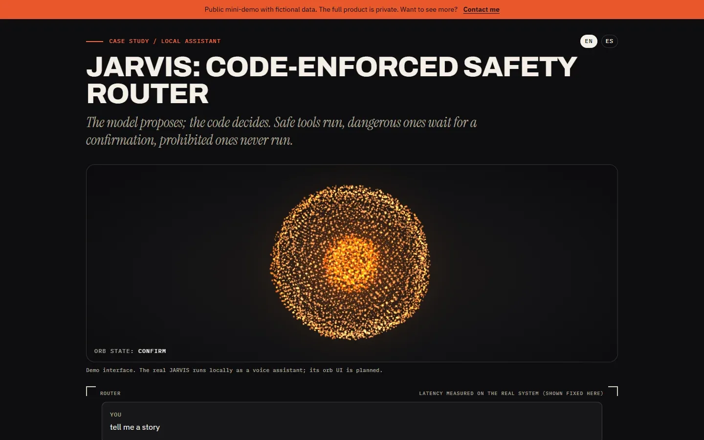
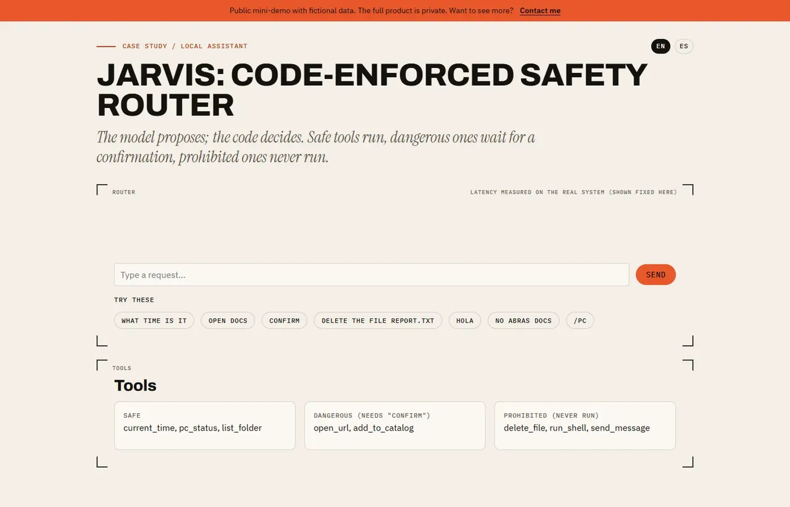

# JARVIS — code-enforced safety router

## Screenshots



| Speaking | Blocked | Confirm |
|---|---|---|
|  |  |  |



> Public mini-demo with fictional data. The full product is private; access on request: carrerabernal@gmail.com

## Live demo

https://carrerable.github.io/jarvis-safety-router-demo/

## What it demonstrates

- A router with a fixed order: confirmation, shortcut, catalog, fast route (regex in Spanish and English), then a simulated LLM.
- Tools split in three sets, enforced in code: safe (run), dangerous (wait for "confirm" or "confirmo"), prohibited (never run: `delete_file`, `run_shell`, `send_message`).
- Veto words (`borra`, `elimina`, `delete`, `remove`, `no`) always send the request to the LLM path.
- Trace chips on every answer. The latencies (2.7 s fast path, 8.6 s LLM path) are measured on the real system and shown as fixed values.

## The orb

A 6,000-particle Three.js orb (written from scratch, `three` pinned to 0.170.0) reacts to the router: `idle` breathing, `listening` wider pulse, `thinking` turbulence in electric blue, `speaking` simulated rhythmic vibration, `blocked` red flash when a prohibited tool is refused, `confirm` amber while a dangerous tool waits for "confirm". Each message plays listening, thinking, speaking, idle (the thinking time is the simulated latency at 25% of its length). An Actions list shows each tool, its level and its result.

- Loaded with a dynamic import after the first paint, so the chat works before the orb appears.
- Pixel ratio capped at 1.5; rendering pauses when the tab is hidden or the orb leaves the viewport.
- `prefers-reduced-motion`: one static frame. No WebGL: a CSS circle with the same state colors.
- The state machine (`src/orb/machine.ts`) is pure and tested without WebGL.

> Demo interface. The real JARVIS runs locally as a voice assistant; its orb UI is planned.

## What is fictional and what is real

There is no real model, no real tool and no network: the "LLM" is a stub and every tool output is fictional. The safety design and the two latencies come from the real, private project. The code is written from scratch.

## Run locally

```bash
npm ci && npm run dev
```

Add `?lang=es` for Spanish.

## Tests

```bash
npm test
```

## How it was built

Code written with Claude Code under my specs and code review; I designed the behavior, wrote the acceptance tests and verified the result.

## Case study

https://carrerable.github.io/en/projects/jarvis/

## License

MIT
